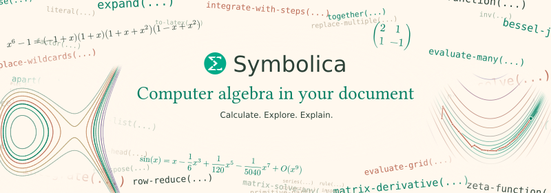
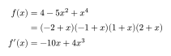
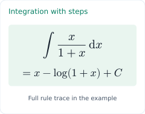
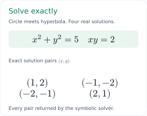
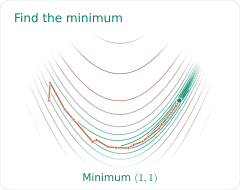

<!-- readme-artwork: banner -->
<picture>
  <source media="(prefers-color-scheme: dark)" srcset="symbolica/readme/banner-dark.svg">
  
</picture>

The official [Symbolica](https://symbolica.io/) plugin for Typst, powered by
Symbolica 3.0. Calculate directly from your Typst formulas and typeset the
results in the same document. Change an equation or parameter and the results
update when you recompile.

**Free for all use within Typst, including academic and commercial work.
No license key required.**

[User manual](symbolica/manual.pdf) · [Minimal example](symbolica/examples/basic.typ) · [More examples](#examples)

## Quick start

Write a polynomial in native Typst math, then factor and differentiate it:

<!-- readme-example: factorization -->
```typst
#import "@preview/symbolica:0.1.0": *

#let x = literal("x")
#let f = parse($x^4 - 5 x^2 + 4$)

$
  f(x) &= #to-typst(f) \
       &= #to-typst(factor(f)) \
  f'(x) &= #to-typst(derivative(f, x))
$
```

<picture>
  <source media="(prefers-color-scheme: dark)" srcset="symbolica/readme/factorization-dark.svg">
  
</picture>

The results are computed exactly as Typst compiles your document. `parse`
reads the formula, `factor` and `derivative` perform the calculations, and
`to-typst` turns each result back into typeset mathematics.

The same import works in the Typst web app and with the command-line compiler;
Typst fetches the package automatically.

## See what you can build

<!-- readme-artwork: integration-steps -->
<!-- readme-artwork: exact-solving -->
<!-- readme-artwork: optimization -->

| Integration with steps | Exact system solving | Optimization valley |
| --- | --- | --- |
| [<picture><source media="(prefers-color-scheme: dark)" srcset="symbolica/readme/integration-steps-dark.svg"></picture>](symbolica/examples/integration.typ) | [<picture><source media="(prefers-color-scheme: dark)" srcset="symbolica/readme/exact-solving-dark.svg"></picture>](symbolica/examples/showcase.typ) | [<picture><source media="(prefers-color-scheme: dark)" srcset="symbolica/readme/optimization-dark.svg"></picture>](symbolica/examples/optimization.typ) |
| Compute an antiderivative and inspect its steps. | Solve, substitute, and check the Jacobian. | Derive gradients and trace optimization steps. |

Click a preview to open the complete Typst example. Symbolica computes the
values; Typst handles the layout and graphics.

The first integration call initializes its rule sets, which may take about
10 seconds. Later calls and ordinary edits reuse the cached rules.

## What can it do?

| Task | Operations |
| --- | --- |
| Exact algebra | Expand, factor, collect, and simplify rational functions |
| Calculus | Differentiate, calculate series, and integrate with steps |
| Equations and matrices | Solve systems exactly or numerically; compute exact matrix results |
| Numerical evaluation | Evaluate real and complex formulas over points or grids |
| Patterns and notation | Replace expressions with wildcards; preserve decorated Typst symbols |

Start with native Typst formulas or strings in Symbolica syntax, such as
`parse("x^2/(1+x)")`. The [manual](symbolica/manual.pdf) explains parsing,
literal labels, namespaces, custom notation, and the complete API.

## Examples

- [Minimal document](symbolica/examples/basic.typ) — your first symbolic calculation
- [Integration with Rubi steps](symbolica/examples/integration.typ) — an antiderivative and its nested rule trace
- [Circle–hyperbola intersections](symbolica/examples/showcase.typ) — exact solving, factorization, substitution, and a Jacobian determinant
- [Batched expression grid](symbolica/examples/expression-grid.typ) — four formulas over a two-dimensional parameter grid
- [Optimization valley](symbolica/examples/optimization.typ) — symbolic derivatives, an exact minimum, and a damped Newton loop written in Typst
- [Lotka–Volterra trajectory](symbolica/examples/lotka-volterra.typ) — batched evaluation inside a Runge–Kutta loop written in Typst
- [Complex phase portrait](symbolica/examples/phase-portrait.typ) — thousands of complex evaluations in one batch

See the [user manual](symbolica/manual.pdf) for concepts, recipes, limitations,
and the full reference, or the [changelog](CHANGELOG.md) for compatibility notes.
The [repository guide](https://github.com/symbolica-dev/symbolica-typst-plugin#reuse-the-rust-library)
covers reuse of the Rust library and symbolic payloads in other plugins.

## Thanks and licensing

This plugin is [free to use for any use within Typst](LICENSE-SYMBOLICA-TYPST.md),
including academic and commercial work.

Thanks to [Parsely](https://typst.app/universe/package/parsely/) for native
Typst-math parsing, [Tidy](https://typst.app/universe/package/tidy/) for the
documentation tools, and [CeTZ](https://typst.app/universe/package/cetz/) and
[CeTZ-Plot](https://typst.app/universe/package/cetz-plot/) for drawing and plotting.
Thanks also to TimeTravelPenguin's
[`symbolic-eval`](https://github.com/TimeTravelPenguin/symbolic-eval) for inspiring
several examples. See the [credits and dependency notices](THIRD_PARTY.md).
